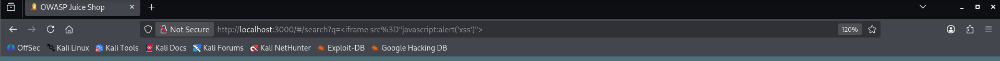
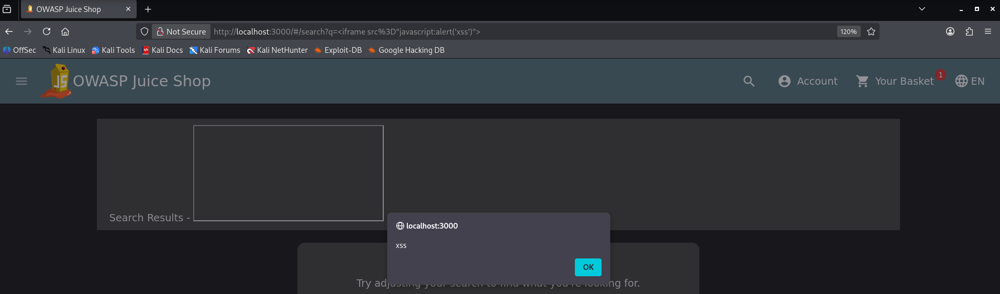
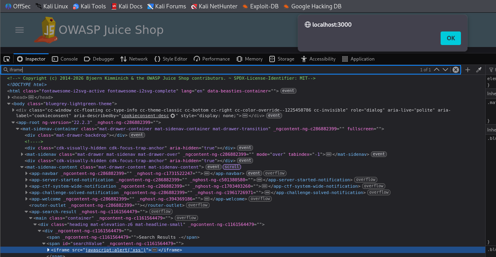

# F-05 - DOM-based XSS in Search

| Field | Assessment |
| --- | --- |
| Severity | Medium |
| CVSS v3.1 score | 6.1 |
| CVSS v3.1 vector | `CVSS:3.1/AV:N/AC:L/PR:N/UI:R/S:C/C:L/I:L/A:N` |
| Status | Confirmed |
| Weakness | CWE-79 |
| Affected feature | `/#/search?q=...; client-side q parameter and searchValue DOM element` |

## Description

The search route renders attacker-controlled q input as an HTML iframe with a javascript URL. The supplied proof-of-concept executes an alert in the browser.

## Prerequisites

A browser visiting the local Juice Shop search route with the supplied input. The evidence shows an existing application session.

## Steps to reproduce

1. Open the search route and supply the iframe payload shown below as q.
2. Submit the search or navigate to the corresponding hash-route URL.
3. Observe the browser alert displaying xss.
4. Inspect the DOM. The screenshot shows the iframe inside span#searchValue under app-search-result.

```text
<iframe src="javascript:alert('xss')">

/#/search?q=%3Ciframe%20src%3D%22javascript%3Aalert%28%27xss%27%29%22%3E
```

## Observed result

The execution screenshot shows the alert, and the inspector screenshot shows an executable iframe inserted into the search result heading. The q input is part of the URL fragment, which is handled by the client application.

## Impact

A crafted search link can cause browser script execution when opened in the application. The captured proof of concept displays an alert. The same execution capability could allow page manipulation or actions under the affected browser session.

## Severity rationale

AV:N/AC:L: the crafted application URL provides a repeatable browser payload. PR:N: the attacker supplies a link without needing application privileges; the victim session is a separate matter. UI:R: the victim must open or submit the crafted input. S:C: the application flaw affects the victim browser security scope. C:L/I:L: injected script can access or change content available to that page. A:N: service availability is unaffected by the assessed outcome.

**Scoring assumptions:** The alert and injected DOM node demonstrate script execution. Limited client-side confidentiality and integrity impacts are reasonable consequences of that execution; broad account takeover is not assumed.

## Remediation

Render search terms as text through framework interpolation or textContent. Avoid inserting user input into raw HTML and avoid sanitizer-bypass APIs. Where rich HTML is required, use a maintained sanitizer and enforce safe element, attribute, and URL-scheme policies.

## Suggested remediation verification

Replay the captured search payload and confirm that no iframe is created and no script runs. The input should appear as inert text or be safely rejected, while ordinary searches continue to work.

## Evidence



Search URL contains the iframe proof-of-concept.



The browser executes the search payload and displays xss.



The inspector shows the iframe inside span#searchValue.

**References:** [OWASP DOM based XSS Prevention Cheat Sheet](https://cheatsheetseries.owasp.org/cheatsheets/DOM_based_XSS_Prevention_Cheat_Sheet.html), [OWASP Cross Site Scripting Prevention Cheat Sheet](https://cheatsheetseries.owasp.org/cheatsheets/Cross_Site_Scripting_Prevention_Cheat_Sheet.html)

**CVSS reference:** [FIRST CVSS v3.1 specification](https://www.first.org/cvss/v3.1/specification-document).
