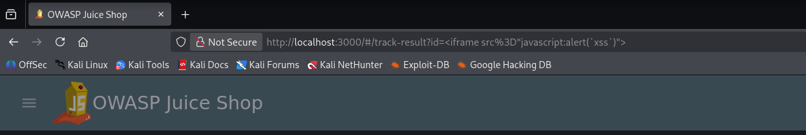
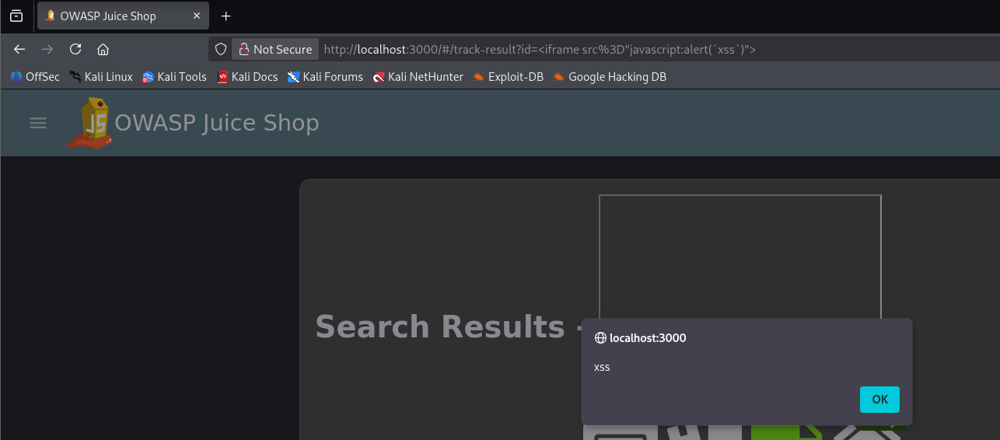
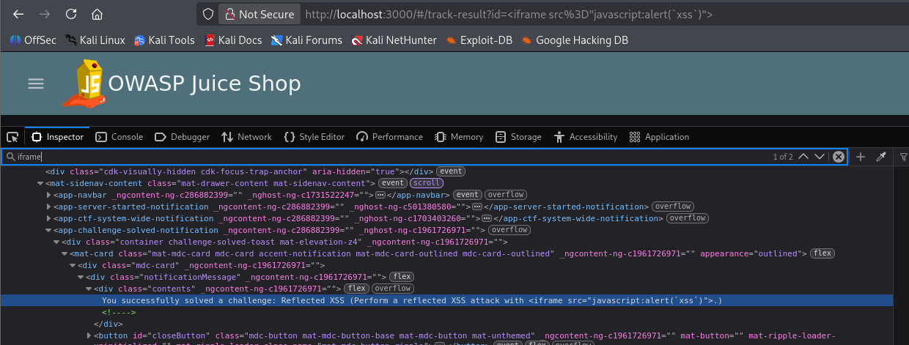

# F-06 - Reflected XSS in Order Tracking

| Field | Assessment |
| --- | --- |
| Severity | Medium |
| CVSS v3.1 score | 6.1 |
| CVSS v3.1 vector | `CVSS:3.1/AV:N/AC:L/PR:N/UI:R/S:C/C:L/I:L/A:N` |
| Status | Confirmed |
| Weakness | CWE-79 |
| Affected feature | `/#/track-result?id=...; id route parameter` |

## Description

Reflected XSS was confirmed through the order-tracking route id parameter. An iframe payload executed JavaScript and displayed an xss alert. The screenshots show the payload, browser execution, and Juice Shop Reflected XSS challenge confirmation. The tester confirmed successful reproduction during a subsequent check.

## Prerequisites

A browser accessing the local Juice Shop application and its order-tracking route.

## Steps to reproduce

1. Open the local application and set the track-result route id value to the iframe payload shown below.
2. Submit the URL by pressing Enter.
3. Observe the xss browser alert.
4. Review the inspector screenshot showing the Juice Shop notification for the Reflected XSS challenge.

```text
<iframe src="javascript:alert(`xss`)">

/#/track-result?id=%3Ciframe%20src%3D%22javascript%3Aalert%28%60xss%60%29%22%3E
```

## Observed result

The tracking payload executed and displayed the xss browser alert. Juice Shop also reported successful completion of the Reflected XSS challenge. Successful reproduction was rechecked and confirmed by the tester.

## Impact

A crafted tracking URL can execute attacker-controlled JavaScript in the application browser context when opened by a user. The demonstrated proof of concept displays an alert; the execution capability could also affect page content or actions permitted to the browser session.

## Severity rationale

AV:N/AC:L: a crafted tracking link triggers the confirmed payload. PR:N: the attacker can construct the link without an application account. UI:R: another user must open it. S:C: browser data and behavior are impacted across the application-to-client authority boundary. C:L/I:L: execution permits limited access to or modification of page/session-accessible content. A:N: the scored effect does not interrupt the service.

**Scoring assumptions:** The finding remains confirmed based on supplied screenshots and the tester recheck. The severity models client-side script execution requiring victim interaction.

## Validation

The finding is confirmed from the supplied screenshots and the tester's subsequent confirmation of successful reproduction.

## Remediation

Validate tracking identifiers against the expected identifier format on the server. Return untrusted values as data and render them with safe text bindings. Apply context-appropriate encoding at rendering boundaries. Use a restrictive Content Security Policy as defense in depth.

## Suggested remediation verification

After remediation, open the captured tracking payload URL in a fresh tab or after a full reload. Confirm that the input is rejected or rendered as inert text, no script executes, and valid tracking identifiers continue to work.

## Evidence



The order-tracking URL contains the id payload.



The tracking payload triggers the xss browser alert.



The inspector shows the Juice Shop Reflected XSS challenge confirmation.

## References

- [Pwning OWASP Juice Shop - Cross Site Scripting](https://pwning.owasp-juice.shop/companion-guide/latest/part2/xss.html)
- [OWASP Cross Site Scripting Prevention Cheat Sheet](https://cheatsheetseries.owasp.org/cheatsheets/Cross_Site_Scripting_Prevention_Cheat_Sheet.html)

**CVSS reference:** [FIRST CVSS v3.1 specification](https://www.first.org/cvss/v3.1/specification-document).
